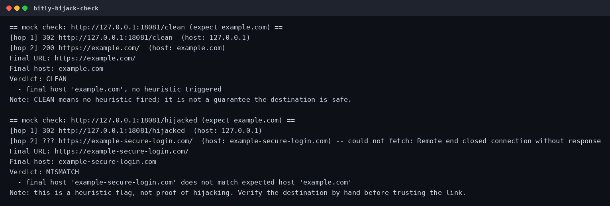

# bitly-hijack-check



**Check where a short link really lands — before you click it.**

A tiny stdlib-only CLI that follows a short link's redirect chain hop by hop and flags anything suspicious about the final destination: a host that isn't the one you expected, a bare IP address, a punycode look-alike, or a second shortener hiding mid-chain.

## Why now

On 2026-11-16, "Old Bitly links are being hijacked" was a top Hacker News story (Ransomnews report; aggregator snapshots show roughly 176–208 points and ~91–112 comments that day). What I verified from the report:

- Bitly confirmed on X on 2026-11-15 at 19:13 UTC that it had "identified an issue that allowed bad actors to repurpose certain old, inactive links" and said it suspended the accounts involved and is disabling the affected links.
- A Bitly link in Burger King's 24 July 2011 tweet was re-registered on 15 Nov 2026 and pointed at Wikipedia's list of Nazi concentration camps; a McDonald's link from 7 June 2011 was re-registered 18 minutes earlier and pointed at Wikipedia's September 11 article. Both were deactivated by Bitly later that day.
- Of 97 bit.ly links in Donald Trump's 2009–2013 tweets, an independent re-check found 57 were no longer the originals (49 re-created years later, 7 deactivated, 1 blocked as malicious) — because Bitly back-halves could be claimed again, contrary to Bitly's own help page.
- The accounts themselves were not hacked. The posts stayed up; only the destination behind the old short link changed.

That is the threat model here: **old short links in old posts, emails, PDFs and printed QR codes can silently point somewhere new.** This tool lets you audit any short link in seconds — no account, no API key, no install beyond Python.

## Quick start (30 seconds)

```bash
git clone https://github.com/Mahgal/bitly-hijack-check.git
cd bitly-hijack-check
python3 bitly_hijack_check.py --mock        # built-in demo (local server + one request to example.com)
```

Check a real link, with the host you expect it to land on:

```bash
python3 bitly_hijack_check.py --url https://bit.ly/19BFiM --expect wikipedia.org
```

## Example output

Real output of `python3 bitly_hijack_check.py --mock` (captured verbatim to `demo.txt`; re-runs reproduce it byte-for-byte — the mock server listens on fixed port 18081):

```
== mock check: http://127.0.0.1:18081/clean (expect example.com) ==
[hop 1] 302 http://127.0.0.1:18081/clean  (host: 127.0.0.1)
[hop 2] 200 https://example.com/  (host: example.com)
Final URL: https://example.com/
Final host: example.com
Verdict: CLEAN
  - final host 'example.com', no heuristic triggered
Note: CLEAN means no heuristic fired; it is not a guarantee the destination is safe.

== mock check: http://127.0.0.1:18081/hijacked (expect example.com) ==
[hop 1] 302 http://127.0.0.1:18081/hijacked  (host: 127.0.0.1)
[hop 2] ??? https://example-secure-login.com/  (host: example-secure-login.com) -- could not fetch: Remote end closed connection without response
Final URL: https://example-secure-login.com/
Final host: example-secure-login.com
Verdict: MISMATCH
  - final host 'example-secure-login.com' does not match expected host 'example.com'
Note: this is a heuristic flag, not proof of hijacking. Verify the destination by hand before trusting the link.
```

The clean fixture lands on `example.com` as expected. The hijacked fixture was *supposed* to land on `example.com` but lands on `example-secure-login.com` — a look-alike host. The tool reports the mismatch; it does not claim the link was hijacked, only that the destination is not the one expected.

## How the verdict works

Every check prints each hop (status code, URL, host), then one verdict:

| Verdict | Meaning |
|---|---|
| `CLEAN` | No heuristic fired. Not a guarantee the destination is safe. |
| `SUSPICIOUS` | A heuristic fired: final host is a bare IP address, contains punycode (`xn--`, a possible look-alike domain), or the chain passes through a second shortener after the first. Treat as "check by hand", never as proof of hijacking. |
| `MISMATCH` | `--expect` was given and the final host is not the expected host. This one is a fact, not a guess — the link does not go where you thought. |

Other behavior:

- Follows up to 10 redirects, 10-second timeout per request.
- If a redirect target is known from a `Location` header but cannot be fetched (host does not resolve, connection fails), it is recorded as a final hop with status `???` and the verdict is still computed from the known host.
- A check that completes exits `0` even for `SUSPICIOUS`/`MISMATCH` — the verdict is output, not a failure. Add `--fail-on suspicious` to exit `1` on any non-`CLEAN` verdict (for CI gates).
- Unreachable first URL / redirect loop exits `1`; bad arguments exit `2`.

## Options

```
python3 bitly_hijack_check.py --url <short-link> [--expect <hostname>]
python3 bitly_hijack_check.py --mock [--fail-on suspicious]
python3 bitly_hijack_check.py --url <url> --timeout 5 --fail-on suspicious
```

## Tests

```bash
python3 -m unittest discover -s tests -v
```

15 tests, all offline against the built-in mock server: redirect-chain parsing, every heuristic rule, mock end-to-end for both fixtures, `--expect` mismatch, timeout, unreachable host, and redirect loop.

## What this tool cannot do

- It cannot prove a link was hijacked. Only the link owner (or Bitly's own `+` info page, which shows a link's creation date) can settle that.
- It cannot see cloaked destinations: a server can redirect different visitors to different places. A `CLEAN` here means "clean for this request, from this machine, right now".
- It does not scan the destination page for malware. Pair it with your browser's safe-browsing warnings and common sense.

## Requirements

Python 3.8+, standard library only. No dependencies, no API key, no account. The `--mock` demo and the tests run against a local server plus one ordinary request to `example.com` (the public example domain) to complete the clean chain.

## License

MIT — see [LICENSE](LICENSE).
